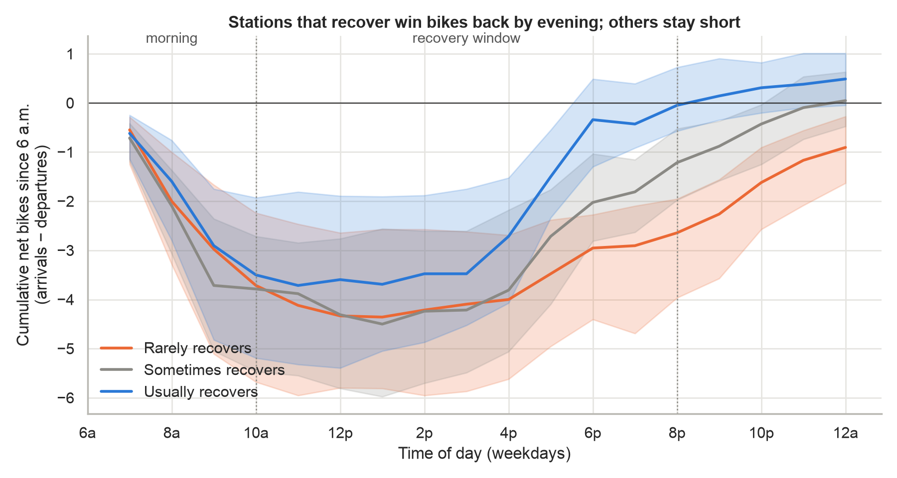
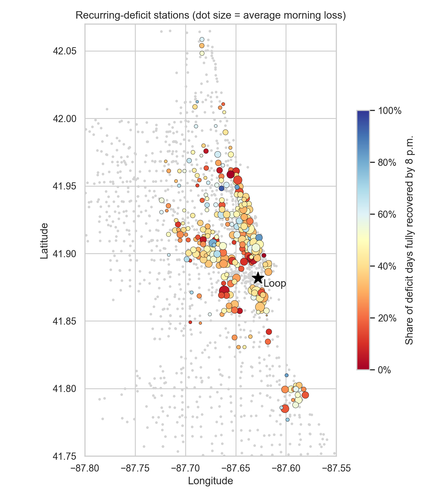
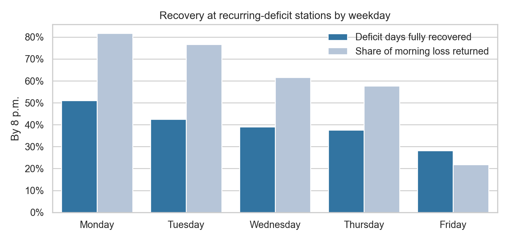

# Preliminary Findings

*Last updated Nov 25, 2026. Numbers come from `notebooks/01_data_cleaning.ipynb`, `notebooks/02_station_recovery_sean.ipynb`, and Mimi's section of the check-in.*

## Data cleaning

| Step | Rides removed | Rides left |
|---|---|---|
| Raw September 2026 file | – | 770,562 |
| Near-duplicate second copies | 4 | 770,558 |
| Shorter than 60 s (false starts / re-docks) | 18,610 | 751,948 |
| Longer than 24 h (lost or stolen bikes) | 633 | 751,315 (97.5%) |

- All missing stations are e-bikes: 27.6% of e-bike rides have no start station, while classic bikes have almost none missing. Station flows therefore undercount e-bikes, which matters for Daniel's bike-type check.
- 66.6% of kept rides have both stations known; these are the rides usable for Surya's route analysis.
- Weather is from Meteostat's Chicago Midway station (72534), since O'Hare has no September precipitation. September had 7 rainy days, only 5 of them weekdays, and only 2 weekdays with heavy rain (≥ 2.5 mm), so weather comparisons rest on few days.
- Labor Day (Mon, Sept 7) is its own day type.

## Whole system

| Day type | Deficit station-days | Full recovery by 8 p.m. | Pooled recovery* |
|---|---|---|---|
| Weekday | 8,548 | 38.6% | 56.7% |
| Weekend | 2,570 | 34.2% | 10.2% |
| Labor Day | 290 | 39.0% | 23.0% |

\*Pooled recovery = total later net arrivals ÷ total morning net departures. The ratio for a single station-day jumps around when the deficit is only 1–2 bikes, so we report the full-recovery rate and pooled recovery together.

Weekend morning deficits are barely made up later in the day, so weekend riding doesn't look like a commute-and-return pattern.

## Sean: station recovery

1. 264 stations start the day short on at least 15 of 21 weekdays. Most of the other 1,259 weekday-active stations rarely do.
2. At these stations, later traffic replaces about 62% of the morning loss (pooled), but full recovery happens on only 39% of deficit days. The median station fully recovers on 42% of its deficit days, with a wide range (0% to 94%).
3. Recovery comes from the evening commute. Stations that usually recover get bikes back mainly between 3 and 6 p.m.; stations that rarely recover are still short at midnight.
   
4. The largest daily losses are at Clark St & Elm St (about 17 bikes a day), Indiana Ave & Roosevelt Rd (13), and Clark St & Lincoln Ave (12). Loomis St & Lexington St, Pine Grove Ave & Irving Park Rd, and Broadway & Cornelia Ave lose bikes almost every weekday and recover less than a third of the loss. Full table: `figures/sean_top_deficit_stations.csv`.
5. Sensitivity checks (`figures/sean_sensitivity.csv`): counting only deficits of at least 5 bikes lowers full recovery to 28% but barely changes pooled recovery. Extending the recovery window to midnight raises pooled recovery to 77%, but most deficit days still don't fully recover. Changing the morning window (7–9 a.m. or 6–11 a.m.) doesn't change the conclusion.
6. Location matters. Recurring deficits are concentrated 2–5 km from the Loop (44% of stations there, vs 18% within 2 km and 5% beyond 10 km), mostly to the north and northwest, with a smaller group around Hyde Park. Stations within 2 km of the Loop gain bikes in the morning, and the 30 recurring-deficit stations that close in recover worst (39% pooled vs 73% at 2–5 km). Table: `figures/sean_distance_bands.csv`.
   
7. Clustering (bonus). k-means on the shape of each station's daily curve gives three groups: 64 stations that recover by early evening (median full recovery 57%), 161 that recover slowly by midnight (39%), and 39 that keep losing bikes after 10 a.m. (19%), which also sit farther from the Loop.
8. Recovery falls through the week. At recurring-deficit stations, 51% of deficit days fully recover on Mondays but only 28% on Fridays, when just 22% of the morning loss comes back (vs 82% on Mondays). September has only 3 non-holiday Mondays and 4 Fridays. Table: `figures/sean_recovery_by_weekday.csv`.
   
9. Which stations lose bikes is stable across the month: deficit-day rates in Sept 1–15 and Sept 16–30 correlate 0.84, and 202 of the top 264 stations are in the top 264 in both halves. Each station's recovery rate is noisier (correlation 0.44), so station-level rates and clusters are rough.

Limitations: trip data can't show whether a station actually ran empty or was restocked by truck, dockless e-bike trips aren't counted, and the data cover one month.

## Mimi: weather and day type

- Full recovery is 38.6% on weekdays and 34.2% on weekends; the median deficit station-day gets back half its loss on weekdays and none on weekends.
- Rainy days show slightly higher full recovery than dry days (weekdays 41.2% vs 38.0%, weekends 38.2% vs 33.3%), possibly because rain means less riding and smaller deficits. This rests on only 7 rainy days.
- Cooler weekdays have the highest full-recovery rate (about 41%), and weekends are below weekdays at every temperature level.

## Still to do

- Daniel (rider contributions) and Surya (route contributions) need early results before the check-in on Mon, Nov 23 at 1:50 pm. Their inputs are `station_day_by_rider.csv` and `trips_clean.csv` from notebook 01.
- The team still needs to pick a presentation session in the check-in.
